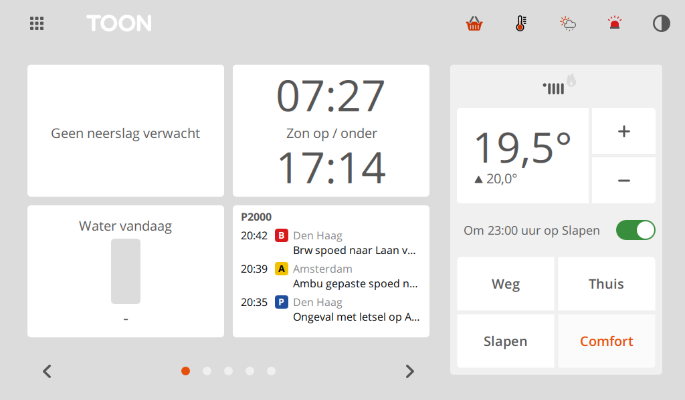
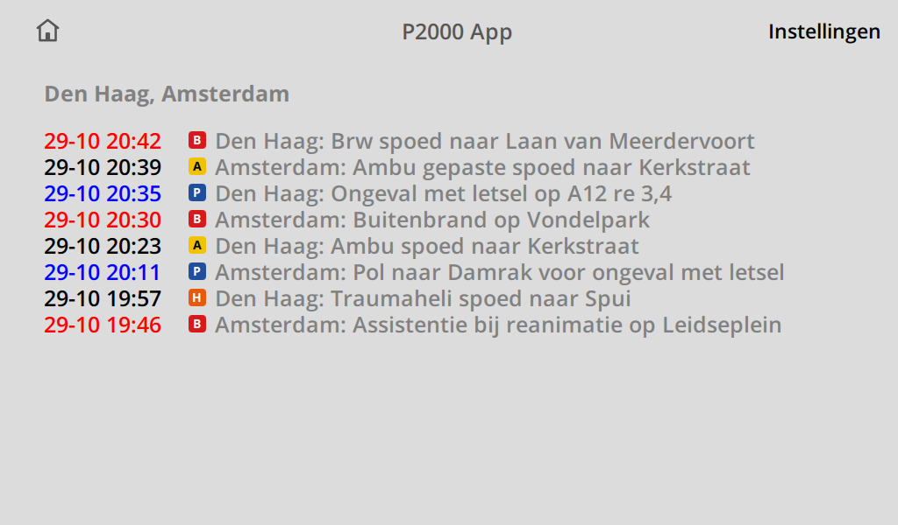
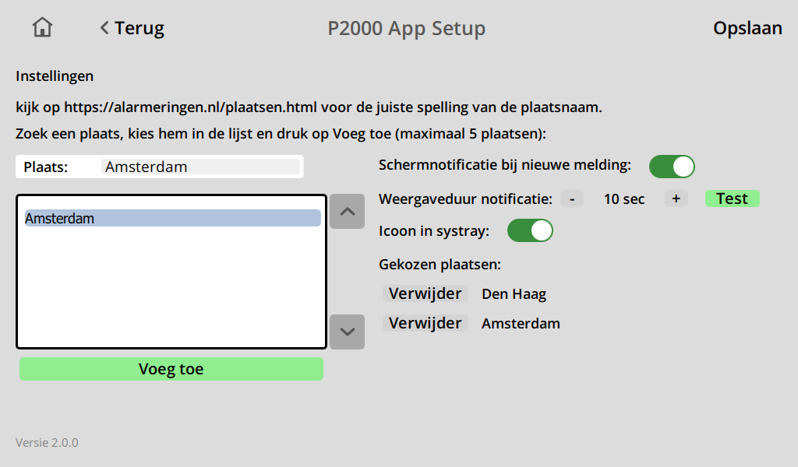
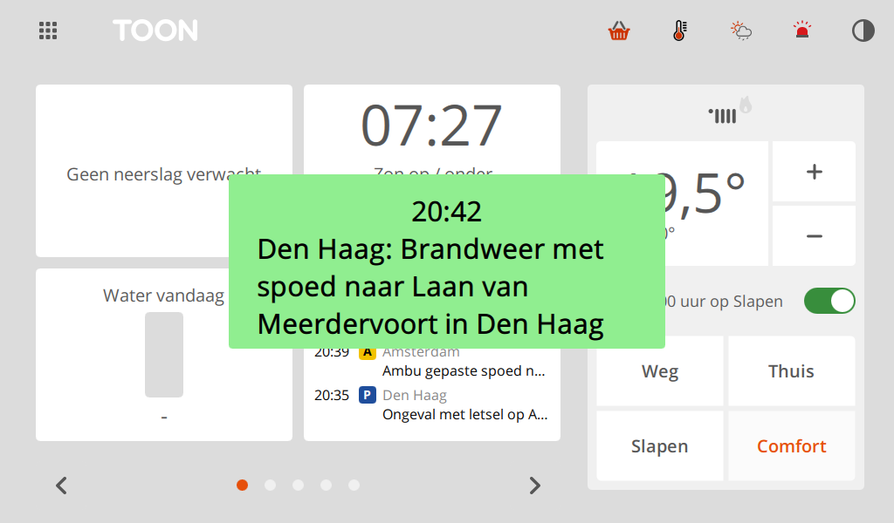

# P2000 for Toon

A Toon app that shows the latest P2000 emergency-service calls (ambulance, fire brigade, police) for
one or more places in the Netherlands. The data comes from the RSS feeds of
[alarmeringen.nl](https://alarmeringen.nl). Originally by oepi-loepi
([oepi-loepi/p2000](https://github.com/oepi-loepi/p2000)).

## What you get

- **A tile** with the 3 most recent meldingen: time, icon and text. When you follow several places,
  the place is on the first line (in grey) and the text below it. A text that doesn't fit ends in
  "…"; the screen shows it in full.
  "met spoed" and "met gepaste spoed" are shortened to "spoed" and "gepaste spoed".
- **A screen** (tap the tile) with the 14 most recent meldingen and their date and time. Fire brigade
  calls are shown in red, police in blue, ambulance and others in black.
- **An icon per melding**, on the tile and the screen: **B** (red) for the fire brigade, **A**
  (yellow) for an ambulance, **H** (orange) for the trauma helicopter, **P** (blue) for the police,
  and a grey square when it isn't clear. The feeds don't say which service a melding is for: the app
  goes by the form of its P2000 text first, then by its words ("Brandweer", "Ambulance", "Politie"):

  | P2000 text | Service |
  |---|---|
  | `p 1 bnn-01 ...` (with a region code), `... brw ...` | fire brigade |
  | `a1 ...`, `a2 ...`, `b1 ...`, `b2 ...` | ambulance |
  | `a0 ...`, or "Traumaheli" in the melding | trauma helicopter |
  | `p 1 ongeval wegvervoer letsel ...` (no region code), `... prio 1 ...`, `... icnum ...` | police |

  The form goes first because the feed's text is sometimes wrong: a police chase
  (`p 1 achtervolging ...`) can come as "Brandweer met spoed naar ...". An exercise (`oefening ...`)
  gets the icon of its service.
- **Motorways:** for a melding on a motorway the feed has the place name as street
  (`Ongeval op <plaats> in <plaats>`). The app then shows the road and hectometre post from the
  P2000 text instead: `Ongeval op A28 re 127,1`.
- **Several places:** follow up to 5 places at once. Their meldingen are combined, newest first, with
  the place name in front (`Assen: Ongeval met letsel op ...`). With one place, the name is left
  out.
- **A notification (optional):** when a new melding arrives, a light-green box with its time and text
  appears in the middle of the screen for 10 seconds (5 to 60, set in the settings), also when the
  screen is dimmed. It appears once
  per melding, only for meldingen that are at most 15 minutes old.

The app checks for new meldingen every minute.

## Screenshots

The tile on the home screen (bottom middle), following two places, and the P2000 icon in the
systray (top right, the red flashing light):



The screen with all meldingen, and the settings screen with two chosen places:





The notification for a new melding:



The screenshots come from the Toon simulator (Toon 2) with made-up meldingen. To make them again:
`set P2000_SCREENSHOTS=1` and then `python tools\run_tests.py readme_screenshots`.

## What you need

- A **rooted Toon** (Toon 1 or Toon 2) with the ToonSoftwareCollective (TSC) software, so it can run
  custom apps.
- An **internet connection** on the Toon.

## Installing

The app isn't in ToonStore, so you install it by hand:

1. **Copy the `p2000` folder to the Toon**, to `/qmf/qml/apps/p2000`. For example, from a PC with an
   SSH client (use your Toon's IP address):

   ```bash
   scp -r p2000 root@192.168.1.10:/qmf/qml/apps/
   ```

   With WinSCP on Windows: connect to the Toon with protocol **SCP**, user `root` and your Toon's
   root password, then drag the folder into `/qmf/qml/apps/`.

   The folder name must be exactly `p2000`: the notification reads its text from
   `/qmf/qml/apps/p2000/event.json`. The files go directly inside it:
   `/qmf/qml/apps/p2000/P2000App.qml`.

2. **Restart the Toon's screen software.** Either use **Restart GUI** in the TSC settings on the Toon
   (the button appears once you unlock the TSC settings there), or run this over SSH:

   ```bash
   killall qt-gui
   ```

   The screen software starts again by itself within a minute.

3. **Add the tile.** On the home screen, tap an empty spot ("Voeg tegel toe") and choose **P2000**.

## Choosing places

1. Tap the tile, then **Instellingen** at the top right.
2. Tap the **Plaats** field and type a place name, for example `Den Haag`.
3. Select the place in the list (use the arrows to move through it) and tap **Voeg toe**.
4. Repeat for up to 5 places. They appear under **Gekozen plaatsen**; **Verwijder** removes one.
5. Switch **Schermnotificatie bij nieuwe melding** on or off, and set how long it shows with
   **Weergaveduur notificatie** (− and +, 5 to 60 seconds in steps of 5). Tap the box to close it
   sooner. **Test** shows a test melding for the duration you set, without saving anything.
6. Optionally switch on **Icoon in systray**: a flashing-light icon at the top of the screen, next
   to the other system icons. Tap it to open the screen with all meldingen. It is off by default.
7. Tap **Opslaan**. The meldingen appear within a minute.

The settings screen shows the app's version at the bottom left.

Use the place names as alarmeringen.nl spells them; [alarmeringen.nl/plaatsen.html](https://alarmeringen.nl/plaatsen.html)
lists them all.

**About searching:** alarmeringen.nl's place search now sends the Toon to a cookie-consent page
instead of a list of places, while the RSS feeds still work. When that happens, the app looks for the
feed of the name you typed. So type the **full** place name: a part of a name ("veen") only finds
something while the site's search works. If the place doesn't exist, the list says
**Plaats niet gevonden, controleer de spelling**.

## Troubleshooting

| What you see | What to check |
|---|---|
| "Selecteer een plaats" | No place is chosen yet: see above. |
| "Wacht op meldingen" stays | The Toon can't reach alarmeringen.nl, or none of the places has meldingen yet. Open the feed in a browser to check: `https://alarmeringen.nl/feeds/city/<place>.rss`, for example `.../den-haag.rss`. |
| "Plaats niet gevonden" | Check the spelling against [alarmeringen.nl/plaatsen.html](https://alarmeringen.nl/plaatsen.html). Spaces become `-` in the feed address. |
| No notification | Does **Test** on the settings screen show one? Is **Schermnotificatie bij nieuwe melding** on? The first check after a restart, or after saving the settings, never notifies; only meldingen that arrive after it do, and only while they are at most 15 minutes old. |

## Files and settings

| Where | What |
|---|---|
| `/qmf/qml/apps/p2000/` | the app |
| `/mnt/data/tsc/p2000_userSettings.json` | the chosen places, the notification settings and the systray option |
| `/qmf/qml/apps/p2000/event.json` | the latest notification's text, written by the app |

Settings from version 1.0.6 and older (one place) are taken over automatically. Those versions don't
know the list of places: if you go back to one, it shows only the first place's meldingen, under the
names of all of them. Choose the place again in its settings to set that right.

## Trying it in toonsim

In the [Toon simulator](https://github.com/ToonSoftwareCollective/toonsim), put the folder in
`toonsim\apps\p2000` and start the simulator, or use **TSC > Restart GUI** if it's already running.
The tests are in `tests\test_p2000.py`; one of them uses the real alarmeringen.nl, so it needs
internet:

```bash
python\python.exe tools\run_tests.py p2000
```

## Removing

Delete the folder `/qmf/qml/apps/p2000` and `/mnt/data/tsc/p2000_userSettings.json`, then restart
the screen software.
